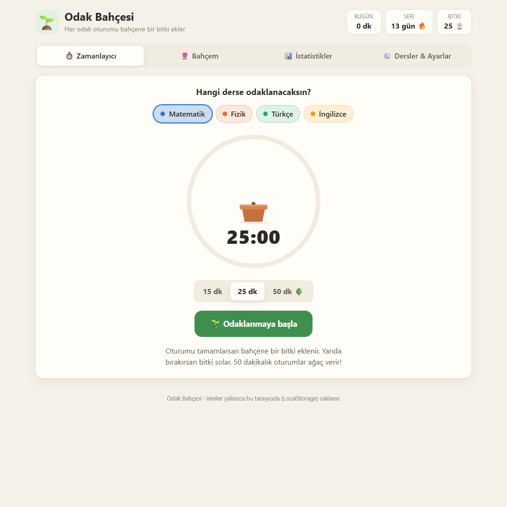
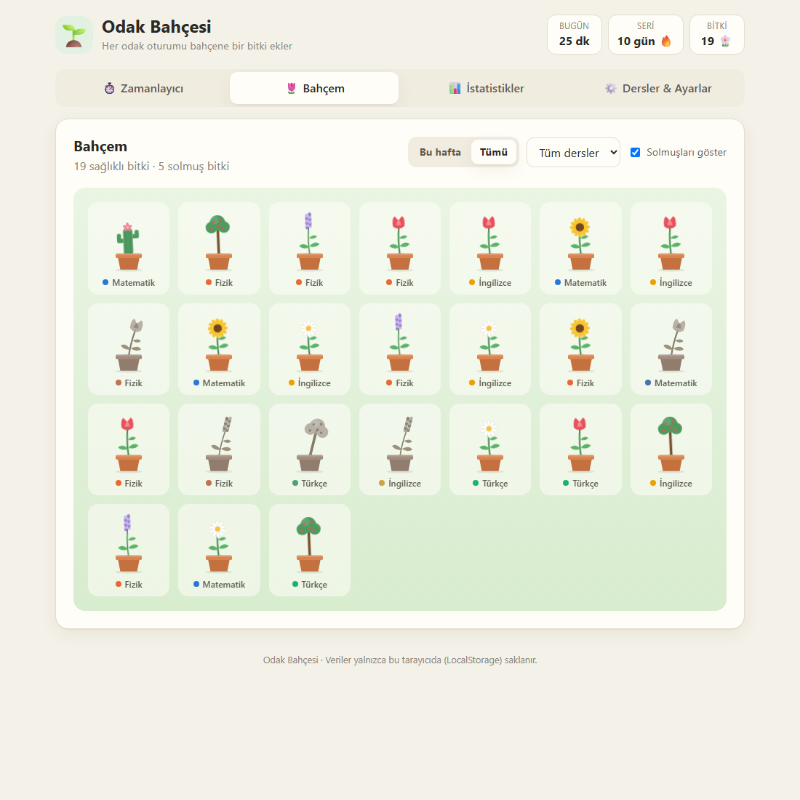
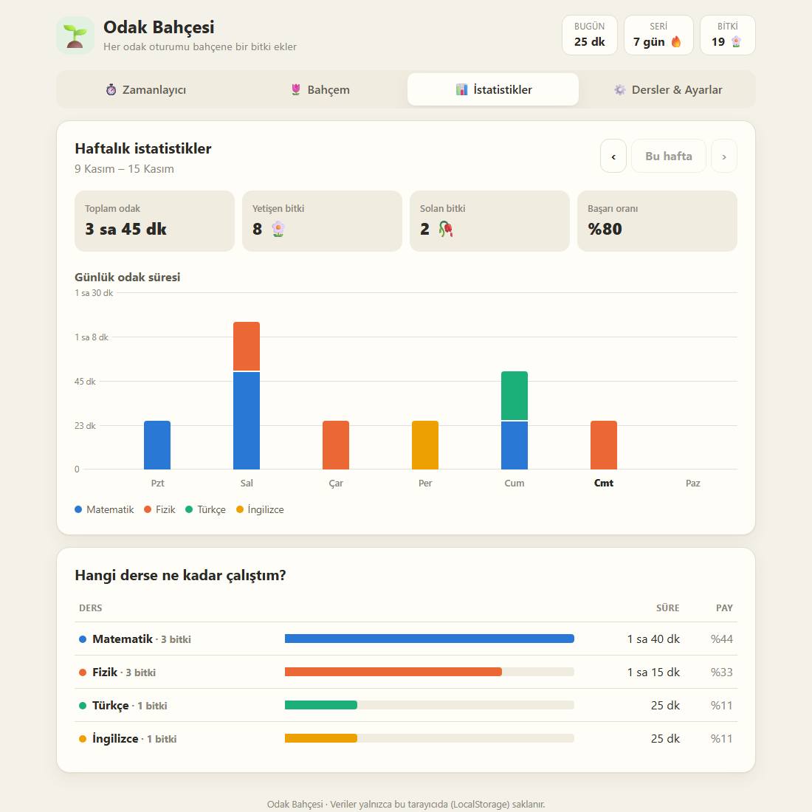

# 🌱 Odak Bahçesi

**Pomodoro ile büyüyen sanal bahçe.** Her odak oturumu bahçene bir bitki ekler; oturumu yarıda bırakırsan bitki solar. Haftalık istatistiklerle hangi derse ne kadar çalıştığını görürsün.

🔗 **Canlı demo:** https://odak-bahcesi.netlify.app (sunum için: `?demo=1` ekleyerek örnek veriyle açılabilir)



| Bahçem | İstatistikler |
|---|---|
|  |  |

## ✨ Özellikler

- **Pomodoro zamanlayıcı:** 15 / 25 / 50 dakikalık odak oturumları, dairesel ilerleme halkası, sekme başlığında geri sayım.
- **Büyüyen bitki animasyonu:** Oturum ilerledikçe tohum → filiz → yaprak → tomurcuk → çiçek aşamalarından geçer.
- **Oyunlaştırma:** Tamamlanan oturum bahçeye bitki ekler, yarıda bırakılan oturum bitkiyi soldurur. 50 dakikalık oturumlar "Mini Ağaç" verir. Günlük seri (🔥) takibi.
- **6 bitki türü:** Lale, Ayçiçeği, Papatya, Lavanta, Kaktüs, Mini Ağaç (hepsi SVG ile çizildi).
- **Bahçem ekranı:** Haftaya / derse göre filtreleme, solmuş bitkileri gizleme, üzerine gelince oturum detayı.
- **Haftalık istatistikler:** Günlere göre ders bazlı yığılmış çubuk grafik, toplam süre, başarı oranı, ders dağılım tablosu, önceki haftalara geçiş.
- **Ders yönetimi:** Ders ekleme, yeniden adlandırma, renk seçme, arşivleme (eski istatistikler korunur).
- **Mola zamanlayıcısı** ve Web Audio API ile ses bildirimi.
- **Sunum modu:** Zamanlayıcı 60 kat hızlı çalışır (25 dk ≈ 25 sn), örnek veri yükleme.
- **Kalıcılık:** Tüm veriler LocalStorage'da. Oturum sırasında sayfa yenilense bile zamanlayıcı kaldığı yerden devam eder.
- **Duyarlı tasarım** (mobil uyumlu), **açık/koyu tema** (sistem tercihine göre), klavye erişilebilirliği.

## 🛠️ Kullanılan Teknolojiler

| Teknoloji | Amaç |
|---|---|
| [React 18](https://react.dev) | Bileşen tabanlı arayüz, `useState` / `useEffect` / `useMemo` / `useRef` |
| [Vite](https://vitejs.dev) | Geliştirme sunucusu ve derleme |
| Saf CSS | CSS değişkenleri, Grid/Flexbox, keyframe animasyonları, `prefers-color-scheme` |
| SVG | Bitki çizimleri ve ilerleme halkası |
| LocalStorage | Verilerin tarayıcıda saklanması |
| Web Audio API | Ek dosya gerektirmeyen bildirim sesi |
| Netlify | Yayına alma |

Harici grafik veya UI kütüphanesi kullanılmadı; grafikler HTML/CSS ile sıfırdan yazıldı.

## 🚀 Kurulum

```bash
git clone https://github.com/simsekbeyda/odak-bahcesi.git
cd odak-bahcesi
npm install
npm run dev        # http://localhost:5173
```

Üretim derlemesi:

```bash
npm run build      # dist/ klasörü oluşur
npm run preview
```

### Netlify'a yayınlama

Depodaki `netlify.toml` dosyası derleme ayarlarını içerir (`npm run build`, yayın klasörü `dist`). Netlify'da **Add new site → Import from GitHub** ile depoyu seçmek yeterlidir.

## 📁 Proje Yapısı

```
src/
├── App.jsx                 # Uygulama durumu, zamanlayıcı mantığı, sekmeler
├── index.css               # Tüm stiller ve animasyonlar
├── components/
│   ├── Header.jsx          # Logo + bugün / seri / bitki sayacı
│   ├── TimerView.jsx       # Ders seçimi, geri sayım, ilerleme halkası
│   ├── Plant.jsx           # SVG bitki (5 büyüme aşaması + solma)
│   ├── GardenView.jsx      # Bahçe ızgarası ve filtreler
│   ├── StatsView.jsx       # Haftalık grafik, KPI kartları, ders tablosu
│   ├── SettingsView.jsx    # Dersler, ayarlar, örnek veri
│   └── ResultModal.jsx     # Oturum sonu kutlama / solma penceresi
└── utils/
    ├── storage.js          # LocalStorage okuma/yazma
    ├── stats.js            # Haftalık istatistik ve seri hesapları
    ├── date.js             # Tarih ve süre biçimlendirme (tr-TR)
    ├── plants.js           # Bitki türleri
    ├── colors.js           # Ders renk paleti
    ├── sound.js            # Bildirim sesi
    └── sampleData.js       # Sunum için örnek veri
```

## 🗂️ Veri Modeli

```js
{
  subjects: [{ id, name, color, archived? }],
  sessions: [{
    id, subjectId, species,
    status: 'completed' | 'withered',
    plannedMinutes, minutes,      // planlanan ve gerçekleşen süre
    startedAt, endedAt            // ISO tarih
  }],
  settings: { focusMinutes, breakMinutes, fastMode, sound },
  active: { type: 'focus' | 'break', subjectId, species, startedAt, durationMs } | null
}
```

Zamanlayıcı kalan süreyi saymak yerine `startedAt + durationMs` bitiş zamanını saklar. Bu sayede sekme arka planda kalsa ya da sayfa yenilense bile süre doğru hesaplanır.

## 🤖 Yapay Zekanın Kullanımı

Proje geliştirme sürecinde **Claude (Claude Code, VS Code eklentisi)** kullanıldı.

| Aşama | Yapay zeka nasıl kullanıldı? |
|---|---|
| **Planlama** | Proje yönergesi ve fikir ("Pomodoro ile büyüyen sanal bahçe") verilerek ekranlar (Zamanlayıcı, Bahçem, İstatistikler, Ayarlar) ve veri modeli birlikte planlandı. |
| **Kurulum** | Vite + React proje yapısı ve Netlify yapılandırması oluşturuldu. |
| **Bileşen üretimi** | SVG bitki bileşeni, ilerleme halkası, yığılmış çubuk grafik ve modal gibi bileşenler yapay zeka ile üretildi, ardından incelenip düzenlendi. |
| **Hata ayıklama** | React StrictMode'da bir oturumun iki kez kaydedilmesi (`useRef` ile korundu), mobilde yatay taşma ve grafik eksenindeki düzensiz değerler (ör. "1 sa 53 dk") yapay zeka ile tespit edilip düzeltildi. |
| **Stil önerisi** | Renk körlüğüne uygun ders renk paleti, koyu tema ve animasyonlar (sallanma, büyüme, konfeti) için öneriler alındı. |
| **Doğrulama** | Uygulamanın ekran görüntüleri tarayıcıda alınarak masaüstü ve mobil görünüm kontrol edildi. |
| **Dokümantasyon** | Bu README dosyasının taslağı yapay zeka ile hazırlandı. |

Örnek istemler:

> "React ile Pomodoro zamanlayıcısı yap. Her 25 dakikalık oturum bahçeye bitki eklesin, yarıda bırakılırsa bitki solsun. Veriler LocalStorage'da tutulsun."

> "Haftalık istatistik ekranı için günlere göre ders bazlı yığılmış çubuk grafik ve hangi derse ne kadar çalışıldığını gösteren tablo yaz."

## 📄 Lisans

MIT
